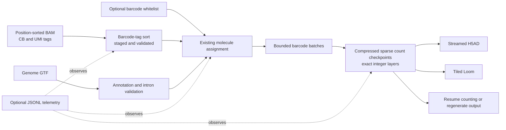

# velocyto-rs-lite

This is my personal fork of [zqfang/velocyto-rs](https://github.com/zqfang/velocyto-rs), a Rust translation of [velocyto.py v0.17.16](https://github.com/velocyto-team/velocyto.py). I’m focusing this fork on bounded counting, resumable work, and output that can be regenerated without reading the BAM files again.

`velocyto-rs` assigns RNA-sequencing reads to genes and counts molecules as **spliced**, **unspliced**, or **ambiguous** for each cell. It reads BAM alignments, a genome annotation in GTF format, and optionally a barcode whitelist, then writes an AnnData H5AD file, a Loom file, or both. It prepares matrices for downstream RNA-velocity analysis; it does not fit a velocity model or infer cell trajectories. The existing molecule-assignment and UMI-counting rules are preserved.

The memory and recovery work targets BD Rhapsody whole-transcriptome datasets of roughly 187,000 cells and 2 billion alignments. Those numbers describe the target workload; a complete production BAM run has not yet been measured with this branch.

## Why I focused on memory and recovery

The earlier command-line path retained dense count batches and made additional copies while combining them. The output writers then assembled whole-dataset matrices before writing sparse files, so sparse output alone did not keep memory bounded. The original audit also found avoidable annotation and read-buffer retention. At an illustrative shape of 187,000 cells × 30,000 genes × 3 `u32` layers, dense count values alone occupy about 62.7 GiB; actual memory depends on the gene count, temporary allocations, and data lifetimes. The approximately 150 GiB Slurm peak is the user's reported observation, not a measurement independently reproduced here.

## What this fork adds

- **Bounded counting:** the command-line workflow consumes barcode batches and releases each batch after it is committed, instead of retaining or cloning all dense batches in memory. A single unusually large barcode/UMI group can still exceed the configured estimate and will fail explicitly.
- **Sparse, persistent checkpoints:** completed batches are stored as compressed sparse integer counts with cell/gene metadata and a per-BAM resume cursor. Checkpoint files are retained so counting can resume or output can be regenerated after interruption.
- **Output without re-counting:** H5AD is written from sparse checkpoint batches; Loom is written in bounded tiles. `write-output` can produce either format from a completed checkpoint without reopening BAMs.
- **Safer sorting and restart:** BAM sorting uses bounded merge fan-in and staged files. A verified completed sort can be reused; an incomplete sort is rebuilt. Abrupt termination may leave sort work files for inspection.
- **Lower avoidable memory use:** release oversized read buffers after a batch, avoid retaining duplicate annotation models, free emptied GTF parsing buffers, stream CIGAR operations, and include CIGAR/tag payloads in sort chunk estimates.
- **Optional telemetry:** `--telemetry-jsonl` records phases, progress, RSS/high-water RSS where available, throughput, checkpoint commits, and errors. A telemetry write failure disables the log and does not stop counting.
- **No new Cargo dependencies** were added for this work. Local executables and build sidecars are ignored; this repository does not yet publish an installer or release binary.

## How the workflow works



**Diagram description:** BAM sorting and GTF annotation feed the existing molecule-assignment logic. It emits bounded barcode batches that are committed as sparse integer checkpoints. Those checkpoints support streamed H5AD or tiled Loom output, resuming counts, and regenerating output later. Optional telemetry observes the run.

## Build and run

Build from source with Rust 1.89 or newer. BAM support is enabled by default. HDF5 development/runtime libraries must be available for the HDF5-backed output writer.

```bash
cargo build --locked --release
```

Example for a BD Rhapsody BAM with `CB` cell-barcode and `MA` UMI tags:

```bash
target/release/velocyto-rs run sample.bam genes.gtf \
  --bcfile whitelist.txt \
  --cb-tag CB --ub-tag MA \
  --sampleid sample \
  --outputfolder results \
  --output-format h5ad
```

The default output is H5AD. Choose `--output-format loom` or `--output-format both` for Loom or both formats. The run command accepts one or more position-sorted BAM files and a GTF. For all commands and options, run:

```bash
target/release/velocyto-rs --help
target/release/velocyto-rs run --help
```

### Memory and telemetry options

| Option | Meaning |
| --- | --- |
| `--cell-batch-size N` | Maximum raw barcodes in a batch. A barcode group is never split. |
| `--count-memory-mb N` | Estimated budget for count read/evidence/scratch components; it is **not** a whole-process or Slurm RSS limit. |
| `--checkpoint-dir PATH` | Select the persistent count-checkpoint directory. Default: `<output-folder>/<sample-id>.counts`. |
| `--resume-from PATH` | Resume matching inputs/settings using a checkpoint. |
| `--telemetry-jsonl PATH` | Append structured phase, memory, progress, and error events. |
| `--samtools-threads N` / `--samtools-memory N` | Set threads and MiB per chunk for the built-in Rust barcode sort. |

For example, to set a smaller batch and write telemetry:

```bash
target/release/velocyto-rs run sample.bam genes.gtf \
  --bcfile whitelist.txt --cb-tag CB --ub-tag MA \
  --cell-batch-size 50 --count-memory-mb 512 \
  --telemetry-jsonl results/sample.events.jsonl
```

### Resume and regenerate output

Counting checkpoints are kept after a successful run and after errors. Resume with the same input files and counting settings:

```bash
target/release/velocyto-rs run sample.bam genes.gtf \
  --bcfile whitelist.txt --cb-tag CB --ub-tag MA \
  --resume-from results/sample.counts
```

Input matching uses canonical path, file size, and modification time, plus the saved settings and checkpoint validation; it does not hash the full BAM contents. Keep source files unchanged when resuming. Resume rebuilds annotation state and repeats intron validation before continuing from the saved BAM cursor.

To create a different output format from a completed checkpoint without processing the BAM again:

```bash
target/release/velocyto-rs write-output results/sample.counts \
  --outputfolder results --output-format loom
```

Checkpoint directories may contain the only recoverable copy of completed count work. Review them before deleting or moving them. Completed count batches are retained; an incomplete staged sort may be rebuilt, while an abrupt termination can leave its staging files behind.

## Counts and output

The sparse checkpoint stores the named count layers as unsigned 32-bit integers. H5AD preserves those integer layer values exactly; H5AD `X` is a float32 total and can round sufficiently large totals. Loom's output dtype can be selected with `--dtype`; `uint16` is smaller but saturates values above 65,535, while the checkpoint retains the original `uint32` counts.

BD Rhapsody tags are supported with `--cb-tag CB --ub-tag MA`. The `--ub-tag` option names the UMI tag and can point to `MA`. Existing tag auto-detection and explicit overrides remain available.

## Verification

- **Fixture differential test:** 8 molecule-logic variants × 3 generated BAM fixtures = 24 runs against the original executable. H5AD and Loom integer layers matched exactly by cell ID and unique gene accession. Fixtures exercise overlap, repeated UMIs, spliced/unspliced/ambiguous evidence, high-depth groups, malformed or missing tags, whitelists, and sorting paths.
- **Rust tests:** `cargo test --locked --offline` passed 90 tests; 2 tests requiring external/large-BAM fixtures were ignored. `cargo test --locked --offline --no-default-features` passed 66 tests.
- **Build checks:** formatting and all-target checks passed with BAM support enabled and disabled. Clippy still reports existing repository warnings.
- **Synthetic storage benchmark:** a controlled sparse writer benchmark measured runtime, child-process peak RSS, logical I/O, and output directory size. It tests checkpoint/output storage only, not BAM decoding or molecule assignment.

| Synthetic mode | Shape | Wall time | Peak RSS | Logical I/O (read / written) | Final directory size |
| --- | ---: | ---: | ---: | ---: | ---: |
| Original dense writer | 3,000 × 10,000 | 0.810 s | 609,844 KiB | 55,619 B / 42,394 B | 1,839,452 B |
| Sparse checkpoint + streamed H5AD | 3,000 × 10,000 | 0.456 s | 29,776 KiB | 742,997 B / 2,188,806 B | 2,675,702 B |
| Sparse checkpoint + streamed H5AD | 187,000 × 30,000 | 94.280 s | 67,680 KiB | 8,828,485 B / 202,253,315 B | 22,406,932 B |

Each synthetic cell had one nonzero in each of three layers. In the 3,000 × 10,000 comparison, the sparse path used about 95% less peak RSS and about 44% less wall time, while using more disk because recoverable checkpoints were retained. The 187,000 × 30,000 run wrote a readable synthetic H5AD of the expected sparse shape. These results do not estimate performance on biological counts or on a Slurm filesystem. The RSS figures cover the benchmark child process, not an entire Slurm job or concurrent process tree.

Raw driver reports: [dense 3,000 × 10,000](docs/benchmark-results/dense-3000x10000.json), [sparse 3,000 × 10,000](docs/benchmark-results/checkpoint-3000x10000.json), and [sparse 187,000 × 30,000](docs/benchmark-results/checkpoint-187000x30000.json).

## Limits and next validation

- The approximately 2-billion-alignment production workload has not been run with this branch. Slurm peak cgroup memory, real BAM runtime, production filesystem I/O, and crash recovery on the target cluster remain unverified.
- `--count-memory-mb` estimates selected counting buffers. It does not cap all process memory, sorting, annotations, HDF5 buffers, allocator overhead, or Slurm job RSS.
- One exceptionally large barcode/UMI group can exceed the estimate. The tool fails explicitly and retains already committed checkpoints; per-molecule evidence spilling is not implemented.
- Resume validates metadata and committed shards, but file identity is path/size/mtime rather than a content hash.
- HDF5/system-library compatibility and runtime behavior on the target cluster are not verified. No installable package or release binary is published yet.

The next performance check should run a representative BAM under the intended Slurm allocation and record `sacct` or cgroup peak memory, runtime by phase, and filesystem I/O. Do not extrapolate the 94-second synthetic output-only benchmark to a 2-billion-record BAM.

## Acknowledgments

The evidence-focused documentation approach was informed by Kassis T, Agarwal V, He Y, Patel D, Brueckner AM. *Scientific Agent Skills: A Library of Procedural Knowledge for Research Agents*. 2026. [doi:10.48550/arXiv.2609.00065](https://doi.org/10.48550/arXiv.2609.00065).
